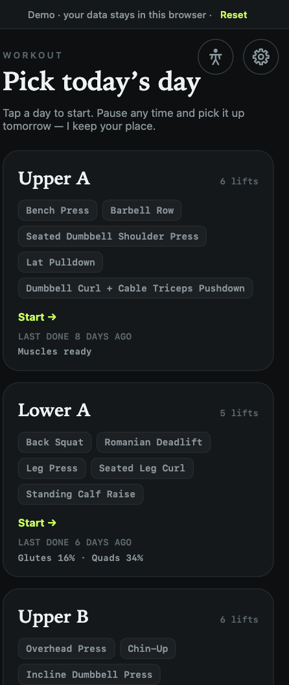
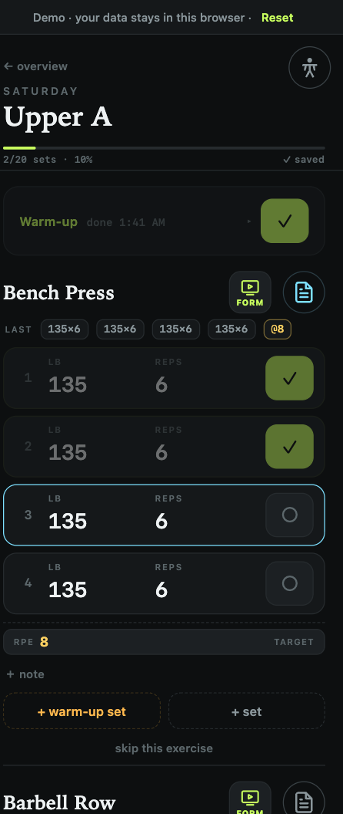
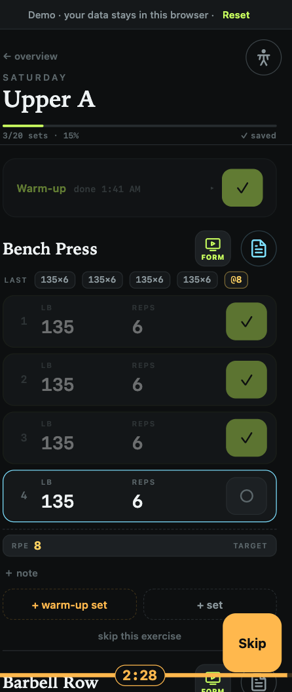
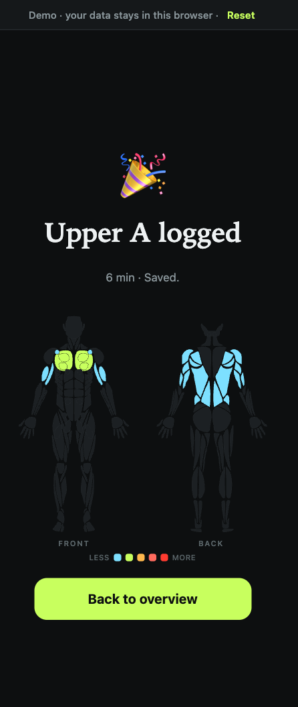
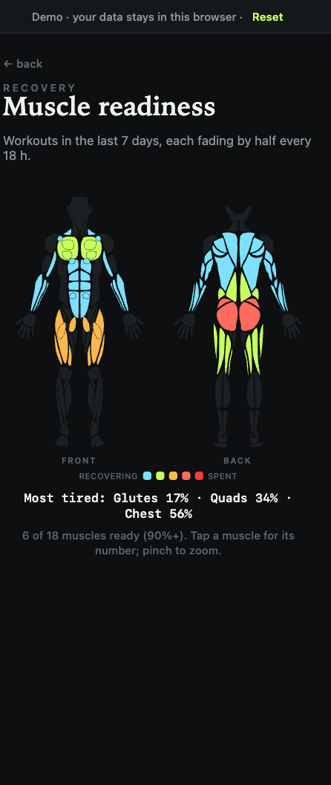
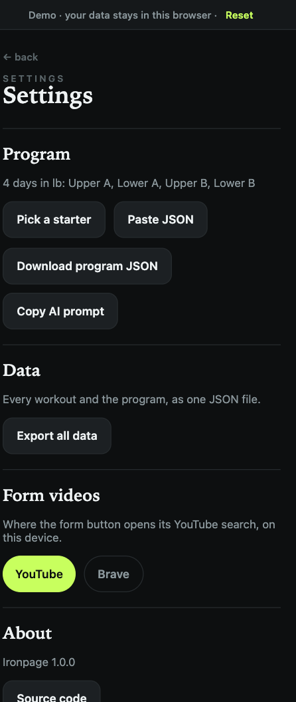
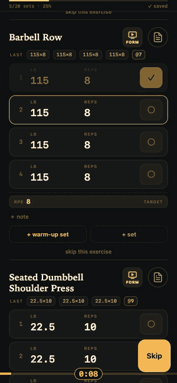
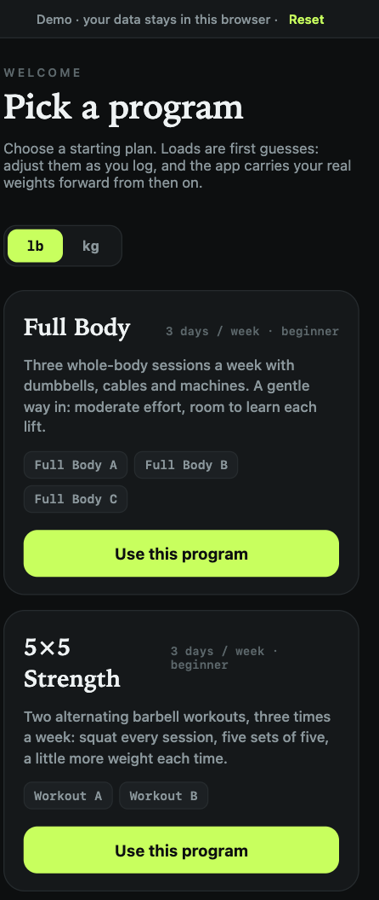
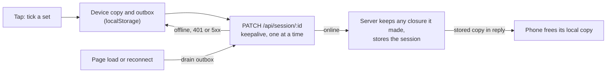

<p align="center">
  
</p>

<h1 align="center">Ironpage</h1>

<p align="center"><strong>Your lifting log, on your Home Screen.</strong></p>

<p align="center">
  <a href="https://github.com/shayan-ys/ironpage/actions/workflows/ci.yml"></a>
  <a href="LICENSE"></a>
  
  
  <a href="CONTRIBUTING.md"></a>
</p>

Ironpage is an offline-first lifting log that lives on your iPhone Home Screen.
There is no app store, no account and no subscription. You deploy it yourself,
and your workouts are plain JSON files in your own Vercel Blob store or Docker
volume. Pick a day, tick sets as you go, rest on a timer, and see a muscle map
when you finish. Because the program is one JSON document behind a small API,
an AI assistant can read your log and write your next program.

- **[Try the demo](https://ironpage-demo.vercel.app/demo/)**. Best on a
  phone. It runs entirely in your browser, and its data stays there.
- **Deploy your own** on Vercel with one click:

  [](https://vercel.com/new/clone?repository-url=https%3A%2F%2Fgithub.com%2Fshayan-ys%2Fironpage&project-name=ironpage&repository-name=ironpage&env=GYM_SECRET&envDescription=Password%20for%20the%20app%20login%20screen%20and%20the%20x-gym-secret%20API%20header.&envLink=https%3A%2F%2Fgithub.com%2Fshayan-ys%2Fironpage%23configuration&stores=%5B%7B%22type%22%3A%22blob%22%2C%22access%22%3A%22private%22%7D%5D)

- **Or run it with Docker:**

  ```bash
  git clone https://github.com/shayan-ys/ironpage.git && cd ironpage
  GYM_SECRET='a long random password' docker compose up -d --build
  ```

<p align="center">
  
  
  
</p>
<p align="center">
  
  
  
</p>

<p align="center">
  
  <br>
  <sub>Tick a set and the rest countdown starts. When it ends, the screen flashes and an alarm loops (not audible in the GIF) until you touch the screen or 10 seconds pass.</sub>
</p>

The screenshots use the demo's made-up program and history.

## Contents

- [Why Ironpage?](#why-ironpage)
- [Features](#features)
- [Get started](#get-started)
- [Your program](#your-program)
- [Configuration](#configuration)
- [API](#api)
- [Data and privacy](#data-and-privacy)
- [How it works](#how-it-works)
- [Development](#development)
- [Roadmap](#roadmap)
- [Credits](#credits)
- [License](#license)

## Why Ironpage?

Apps like Strong and Hevy are polished native apps. They have large exercise
libraries, charts, Apple Watch support and social features, and they work well.
Ironpage is smaller and makes different trade-offs:

| | Ironpage | Typical workout app |
| --- | --- | --- |
| Where your data lives | JSON files in your own Blob store or volume | The vendor's cloud |
| Account | None. One password for your own deployment | Vendor account |
| Price | Free and open source (MIT). You pay only for hosting, if anything | Free tier, paid upgrades |
| Offline | Yes. Every change is saved on the phone first | Usually yes |
| Edit with scripts or AI | Yes. A JSON API, a JSON Schema and a ready-made AI prompt | Limited, usually CSV export |
| Install | Add to Home Screen from Safari. No app store | App store |
| Users | One person per deployment | Many, with social features |
| Platforms | iPhone first. Android and desktop browsers work, with less polish | Native iOS and Android |

Choose Ironpage if you want to own the log, change it with your own tools, and
host it yourself. Choose a native app if you want a large exercise library,
watch support or to train with friends.

## Features

**Programs**

- **Starter programs on first run.** Full Body, 5×5 Strength, Upper / Lower and
  Push / Pull / Legs. Pick one, then change it to suit you.
- **kg or lb.** The program sets its unit, and every weight, label and ramp-set
  rounding step follows it.
- **Ramp sets.** Planned warm-up sets are logged as leading rows. They never
  count as working volume or lower the weights that seed the next session.
- **Weekly target ladders.** Optional dated steps that set a minimum weight, and
  can change sets, reps and ramp sets, week by week.
- **Pre-filled sets.** Weights carry over from the last time you did the lift,
  floored by the current target step.

**In the gym**

- **Supersets.** Ticking a set scrolls to the partner exercise's next set.
- **Rest timer and flash alarm.** A countdown bar with a Skip button. When it
  ends, the screen flashes and an alarm loops until you touch the screen or
  10 seconds pass.
- **Timed holds.** Exercises measured in seconds get a full-screen countdown
  that ticks the set when it ends.
- **One RPE per exercise.** Five tap stops, 6 to 10.
- **Notes sheet.** Last time's note, the program's setup and form cues, the
  weekly targets with the current week highlighted, the worked muscles, and
  what to do next.
- **Form videos.** A button on each exercise opens a YouTube search for its
  form, in the browser or in the Brave app (set per device in Settings).
- **Haptics in a PWA.** Every button and link gives a tap on iPhone, and
  scrolling from a button still scrolls. Android gets graded vibration patterns.

**After the workout**

- **Muscle heat map.** The finish screen shows a front and back map of the
  session, weighted by effort, with its duration and how it felt.
- **Readiness.** A recovery page and a hint on each day card show which muscles
  are still recovering, using an 18-hour half-life over the last 7 days.

**Reliability**

- **Offline-first sync.** Every change is saved on the phone first and sent when
  there is signal. A workout finished offline is retried until the server has
  it.
- **Pause and resume.** Pause a session and come back to it. A session idle for
  24 hours asks before it resumes, and one idle for 72 hours closes itself,
  dated by its last logged set.
- **Update check.** The installed app reloads quietly when a newer build is
  deployed.

**Settings and integrations**

- **Settings page.** Replace the program from a starter or by pasting JSON
  (validated before upload, with one message per problem), download the
  program, export all data, copy an AI prompt, and choose the form-video
  browser.
- **Optional coach link.** Set `NEXT_PUBLIC_COACH_URL` to show a Coach button on
  an open session that links to a tool you host.

## Get started

### 1. Deploy to Vercel

Click **Deploy with Vercel** above. Vercel copies the repository to your GitHub
account, creates a project with a **private** Blob store connected to it, and
asks for `GYM_SECRET`, the password for your app. Use a long random value.

When the deploy finishes:

1. Open the deployment URL in Safari on your iPhone.
2. Tap **Share**, then **Add to Home Screen**.
3. Open Ironpage from the Home Screen and log in with your `GYM_SECRET`.
4. Pick a starter program and a unit.

### 2. Docker

[`compose.yaml`](compose.yaml) builds the image and keeps your data in a named
volume, `ironpage-data`, mounted at `/app/.data`.

```bash
git clone https://github.com/shayan-ys/ironpage.git && cd ironpage
GYM_SECRET='a long random password' docker compose up -d --build
```

The app listens on port 3000 (set `PORT` to change it). Compose refuses to
start without `GYM_SECRET`. The data survives rebuilds and
`docker compose down`; `docker compose down -v` deletes it.

> [!NOTE]
> Put an HTTPS reverse proxy (Caddy, Traefik, nginx) in front of it. iPhone
> installs and offline use need HTTPS, because browsers run service workers only
> on secure origins. Behind a proxy that sends `X-Forwarded-Proto: https`, the
> login cookie is marked `Secure`. Plain HTTP on your LAN still lets you log in
> and log workouts.

To build without Compose, use the [`Dockerfile`](Dockerfile) directly. It runs
as a non-root user and checks its health on `/api/version`.

### 3. Local development

You need Node.js 20.19+, 22.13+ or 24+.

```bash
git clone https://github.com/shayan-ys/ironpage.git && cd ironpage
npm install
BLOB_READ_WRITE_TOKEN= GYM_SECRET= npm run dev
```

Open <http://localhost:3000>. With both variables empty, data is stored as JSON
files in `.data/` and the login screen is off.

> [!WARNING]
> Do not run `npm run dev` with a real `BLOB_READ_WRITE_TOKEN` loaded. It would
> read and write your real workouts.

To try it on a phone, see [Try it on a phone](CONTRIBUTING.md#try-it-on-a-phone)
in the contributing guide.

## Your program

The program is one JSON document: a unit, then days, then exercises with sets,
reps, target RPE, rest, supersets, muscle scores, notes and optional weekly
targets. The full shape is `Program` in [`lib/types.ts`](lib/types.ts).

<p align="center">
  
</p>

There are four ways to set it:

- **Starter.** On first run, pick one of the
  [starter programs](lib/starter-programs/index.ts). You can switch to another
  later in Settings.
- **Paste JSON.** In **Settings**, paste a program. It is checked before upload,
  and every problem is listed with its path.
- **Ask an AI assistant.** In **Settings**, tap **Copy AI prompt**. Paste it into
  ChatGPT, Claude or similar, add your own program in any format, and paste the
  JSON reply back into Settings. The prompt points the assistant at your app's
  JSON Schema.
- **Use the API.** Replace the program from a script. It takes effect at once,
  with no deploy:

  ```bash
  curl -X PUT "https://<your-app>/api/program" \
    -H "x-gym-secret: $GYM_SECRET" \
    -H 'content-type: application/json' \
    -d @program.json
  ```

  An invalid program gets `400` with `{ "error", "errors" }`, one
  `path: problem` string per mistake.

The JSON Schema (draft-07) is served at `/program.schema.json` on every
deployment, without login. The source is
[`public/program.schema.json`](public/program.schema.json). Point your editor
at it for autocomplete.

Two rules to know:

- **Exercise ids carry history.** Pre-filled weights and "last time" notes are
  looked up by exercise `id`. Keep the id when a lift continues into a new
  program. A changed id starts with no history. Settings warns you before a
  replacement drops ids.
- **Weights are in the program's unit.** Every weight in the program
  (`seedWeight`, and `weightLb` on targets and ramp sets) is in `unit`, `lb` or
  `kg`. The `Lb` suffix on field names is historical.

## Configuration

Set these as environment variables (Vercel project settings, `.env.local`, or
your shell for Docker). [`.env.example`](.env.example) lists them all.

| Variable | Default | Purpose |
| --- | --- | --- |
| `GYM_SECRET` | empty | Password for the login screen, and the value of the `x-gym-secret` header for scripts. Empty turns the login gate off: use that for local development only. |
| `GYM_READ_SECRET` | empty | Optional read-only secret. Sent as `x-gym-secret`, it allows only `GET /api/program` and `GET /api/session/<id>`. Use it for a coach or assistant that should not change data. |
| `BLOB_READ_WRITE_TOKEN` | empty | Vercel Blob token. When set, data is stored in Vercel Blob instead of `.data/`. |
| `BLOB_STORE_ID` | empty | Also selects Vercel Blob. Vercel sets it when a store is connected through OIDC instead of a token. |
| `BLOB_ACCESS` | `private` | Access mode of the Blob store, `private` or `public`. It must match how the store was created. |
| `NEXT_PUBLIC_COACH_URL` | empty | Link for a Coach button on an open session. `{sessionId}` is replaced with the session id, for example `https://coach.example.com/review?session={sessionId}`. Compiled into the client, so set it before `npm run build` (for Docker, as a build argument). Empty hides the button. |

## API

All requests and responses are JSON. When `GYM_SECRET` is set, every route
except `/api/login` needs either the login cookie or the `x-gym-secret` header.
Routes marked **header** check the header themselves. **Read-only** means the
`GYM_READ_SECRET` header also works; it is refused everywhere else.

| Method | Path | What it does | Auth |
| --- | --- | --- | --- |
| `POST` | `/api/login` | Check `{ password }` and set the login cookie | none |
| `GET` | `/api/program` | The current program (`404` before one is stored) | cookie, header, read-only |
| `PUT` | `/api/program` | Replace the program after validation | header, or cookie from the same origin |
| `GET` | `/api/session` | The open session, or `null` | cookie, header |
| `POST` | `/api/session` | Start a session: `{ dayId }` | cookie, header |
| `GET` | `/api/session/:id` | One session | cookie, header, read-only |
| `PATCH` | `/api/session/:id` | Save the whole session | cookie, header |
| `DELETE` | `/api/session/:id` | Delete a session | header only |
| `GET` | `/api/export` | The program and every session in one bundle | header, or cookie from the same origin |
| `GET` | `/api/version` | The deployed build id, for update checks | cookie, header |

`/program.schema.json` and the PWA shell assets (service worker, manifest,
icons) are open. With `GYM_SECRET` empty, every route is open.

Export everything from a script:

```bash
curl "https://<your-app>/api/export" -H "x-gym-secret: $GYM_SECRET" > ironpage-export.json
```

## Data and privacy

- **Your deployment.** Data is stored where you run it: `program.json` and one
  `sessions/<id>.json` per workout, in your Vercel Blob store or in `.data/`
  (the Docker volume). Use a private Blob store, which is the default.
- **Your phone.** The app keeps a copy of open sessions and unsynced changes in
  the browser's `localStorage`, and the service worker caches pages so the app
  opens without signal.
- **The demo.** The demo has no server. Its program and made-up history live in
  your browser's `localStorage` and never leave the device. The **Reset** button
  in the demo bar clears them.
- **Export.** Settings has **Export all data**, which downloads one JSON file
  with the program and every session. Scripts can use `GET /api/export`.
- **No telemetry.** Ironpage has no analytics or tracking, and the app loads
  nothing from third parties. The only outside link is the form-video button,
  which opens YouTube when you tap it.

See [`SECURITY.md`](SECURITY.md) for the threat model and how to report a
problem.

## How it works

- **Next.js App Router.** Server components render the overview, session,
  recovery and settings pages. API routes read and write JSON through one
  storage adapter, [`lib/store.ts`](lib/store.ts): Vercel Blob when configured,
  the file system otherwise.
- **Offline outbox.** Every change is written to `localStorage` at once, then
  sent as a `PATCH` of the whole session ([`lib/localsync.ts`](lib/localsync.ts)).
  Requests are serialised per session and use `keepalive`, so closing the app
  right after **Finish** cannot cancel the save. A component in the root layout
  drains the outbox on every page load and reconnect.
- **Server keeps closures.** The server accepts the phone's set data, but a stale
  copy cannot reopen a session the server has already finished or timed out.
- **Derived state.** The rest timer, the current set, the muscle map and
  readiness are computed from the log, not stored. There is no cron job: the
  72-hour auto-close runs when the overview is read.
- **Service worker** ([`public/sw.js`](public/sw.js)). Pages are network-first
  with a cached fallback. Static assets are stale-while-revalidate. API calls are
  never cached; the outbox owns offline writes.
- **iPhone haptics.** Safari has no Vibration API. Its only web haptic is the
  tick of a native `<input type="checkbox" switch>` when a real tap toggles it.
  Ironpage lays a transparent `<label>`, wired to a hidden switch, over each
  button and link, then forwards the click to the element underneath. A scroll
  that starts on a button still scrolls. See [`lib/haptics.ts`](lib/haptics.ts).



## Development

```bash
npm run lint         # ESLint
npm test             # Vitest
npx tsc --noEmit     # type check
npm run build        # production build
npm run demo:build   # build the GitHub Pages demo and landing page into out/
npm run demo:serve   # serve out/ locally under the Pages base path
```

CI runs lint, tests, the type check and the build on every pull request.

| Path | What lives there |
| --- | --- |
| `app/` | Pages (overview, session, recovery, settings, login) and API routes |
| `components/` | UI: set rows, rest timer, sheets, muscle map, settings |
| `lib/` | Domain logic: storage, sync, rest, supersets, ramp sets, muscles, validation |
| `lib/starter-programs/` | The first-run starter programs |
| `lib/demo/` | The browser-only demo: a `localStorage` store and an `/api` shim |
| `public/` | PWA manifest, service worker, JSON Schema, alarm sound |
| `site/` | The static landing page for GitHub Pages |
| `scripts/` | Demo build and the Deploy to Vercel link |
| `tests/` | Vitest tests for `lib/` |

Before you change behaviour, read [`AGENTS.md`](AGENTS.md). It records the rules
that protect saved workouts: offline sync, how sessions open and close, ramp
sets, units and iOS quirks. [`GLOSSARY.md`](GLOSSARY.md) defines the app's
vocabulary. [`CONTRIBUTING.md`](CONTRIBUTING.md) covers setup, checks and pull
requests, and [`CHANGELOG.md`](CHANGELOG.md) lists releases.

## Roadmap

Ideas, not promises:

- A visual program editor, so changing a program does not mean editing JSON.
- Android polish: install prompts, haptics and layout tested on more devices.
- Import from other workout apps' CSV exports.
- Progress charts per lift.

Want to help? Start with a
[good first issue](https://github.com/shayan-ys/ironpage/labels/good%20first%20issue).

## Credits

- The body-map geometry comes from MuscleMap by Melih Colpan, MIT licensed
  ([`public/MuscleMap-LICENSE`](public/MuscleMap-LICENSE)).
- Bottom sheets use [Base UI](https://base-ui.com/).
- The rest alarm sound was synthesised for this project.

## License

[MIT](LICENSE) © Shayan Yousefian
